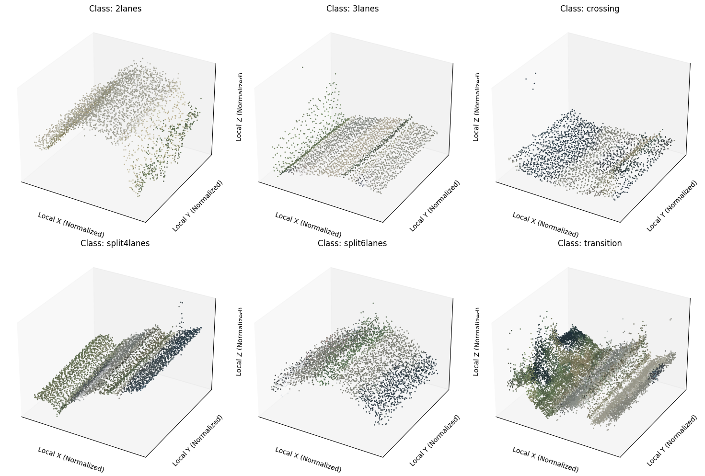
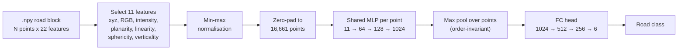
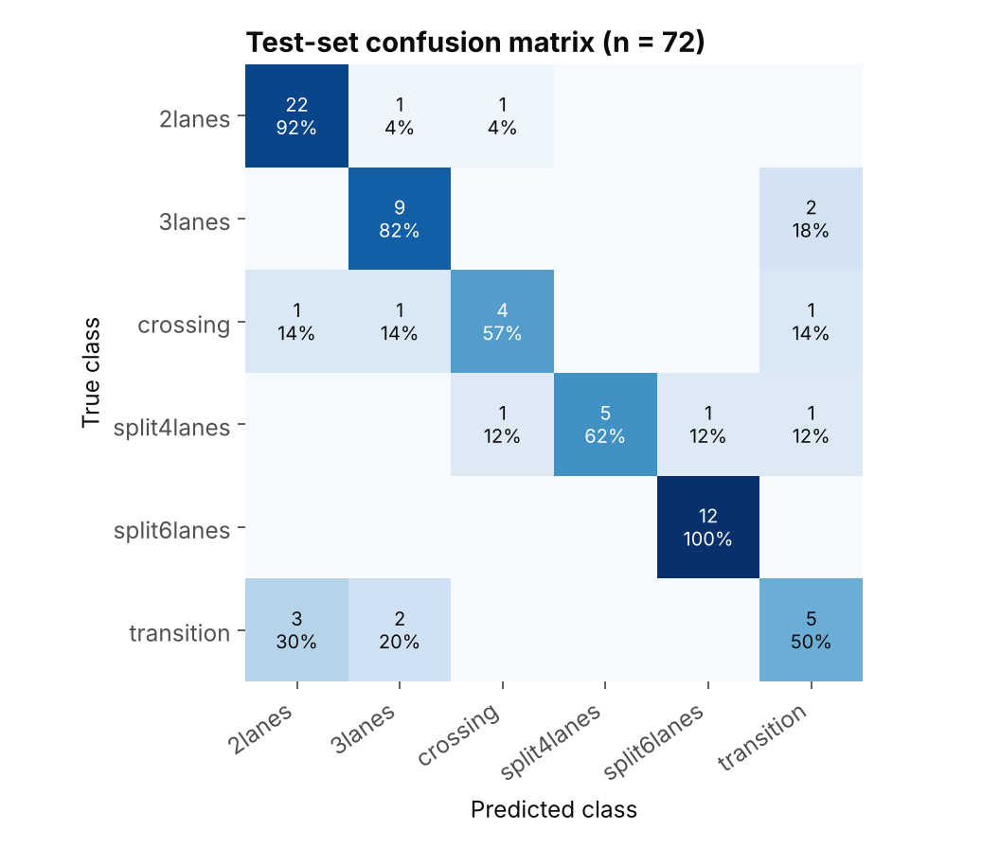
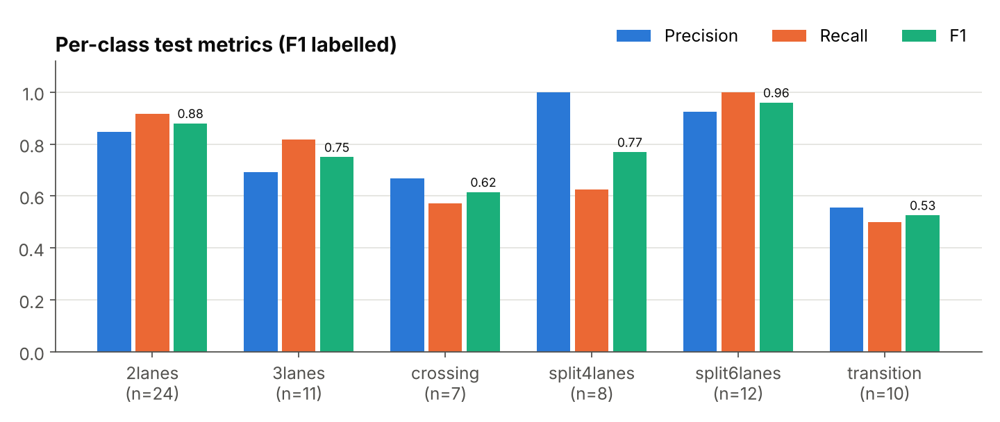

# Road Block Classification from Airborne LiDAR Point Clouds


A deep learning model that looks at a raw 3D point cloud of a road segment and tells you what kind of road it is: a 2-lane road, a 3-lane road, a divided 4-lane or 6-lane carriageway, a crossing, or a transition zone.

The model is a compact **PointNet-style network built from scratch in PyTorch**. It works directly on the raw points (11 features per point), with no conversion to images or voxels.

| Test accuracy | Weighted F1 | Weighted precision | Model size |
|:---:|:---:|:---:|:---:|
| **79.2 %** | **78.6 %** | **79.5 %** | 0.8 M parameters (3.1 MB) |


*One randomly chosen road block per class, coloured by its RGB values.*

---

## Why this matters

Road authorities need up-to-date inventories of their network: how many lanes, where carriageways split, where junctions are. Airborne laser scanning (ALS) captures this geometry for whole regions, but turning millions of points into labelled road sections is still largely manual. Automatically classifying road blocks is a building block for **road asset management, digital twins of road infrastructure, and HD map generation**.

## Approach in one picture



Key design choices:

- **Direct point input.** Every point keeps its full feature vector, so no information is lost in a 2D projection.
- **Permutation invariance.** Max pooling across points means the order of points in the file does not matter.
- **Class-weighted loss.** The largest class (2 lanes) is about 3.5 times bigger than the smallest (crossing) in the training split, so inverse-frequency weights stop the model from favouring it.
- **Regularisation against a small dataset.** Dropout 0.4, weight decay 5e-4, learning-rate reduction on plateau and early stopping.

Full details: [docs/METHODOLOGY.md](docs/METHODOLOGY.md)

## Results

Evaluated on a held-out test split of 72 road blocks that the model never saw during training or model selection.

| Metric | Value |
|---|---|
| Test accuracy | 79.17 % |
| Weighted precision | 79.48 % |
| Weighted recall | 79.17 % |
| Weighted F1-score | 78.63 % |
| Weighted IoU (Jaccard) | 66.97 % |
| Best validation accuracy | 76.06 % |

<p align="center">
  
</p>



**What the model gets right:** divided 6-lane roads are recognised perfectly (12 of 12), and 2-lane roads reach an F1 of 0.88.

**Where it struggles:** *transition* blocks (F1 0.53) are confused with 2- and 3-lane roads. That makes sense: a transition is by definition a road that is changing from one lane configuration to another, so it shares geometry with both.

Full analysis: [docs/RESULTS.md](docs/RESULTS.md)

## What I learned from the experiments

1. **Normalisation was the single biggest improvement.** The raw features live on very different scales (intensity up to 65,535, geometric features between 0 and 1); scaling them to a common range made training stable.
2. **Data augmentation hurt.** Random rotation, jitter, scaling, shifting and point dropout all reduced accuracy. A likely reason is that road blocks have a meaningful orientation and lane geometry, so changing them blurs the differences between classes. Augmentation is therefore off by default (it can be switched on with `--augment`).
3. **11 features is the sweet spot.** Both adding more of the 22 available features and removing any of the 11 lowered accuracy.
4. **Dropout and weight decay reduce overfitting but do not remove it.** Training accuracy reached 94.7 % while validation stayed around 75 %, which points to the size of the dataset as the main limit.

## Repository structure

```
├── src/
│   ├── config.py          # feature indices, class names, hyperparameters
│   ├── dataset.py         # loading, normalisation, padding, augmentation
│   ├── model.py           # SimplePointNet
│   ├── metrics.py         # evaluation helpers
│   ├── train.py           # full training + test evaluation
│   └── predict.py         # classify new .npy files with the trained model
├── models/
│   ├── simplepointnet_best.pth      # trained weights (best validation accuracy)
│   └── normalization_stats.json     # min/max values the model was trained with
├── notebooks/
│   └── road_pointcloud_classification.ipynb   # original experiment, with outputs
├── results/training_log.txt         # raw output of the reported run
├── scripts/make_figures.py          # rebuilds the figures from the log
├── docs/                            # methodology, results, figures
└── data/README.md                   # dataset layout and format
```

## Getting started

```bash
git clone https://github.com/saad261/road-pointcloud-classification.git
cd road-pointcloud-classification
pip install -r requirements.txt
```

**Classify road blocks with the trained model** (CPU is fine):

```bash
python src/predict.py path/to/block.npy
python src/predict.py path/to/folder_with_npy_files --top-k 3
```

**Train from scratch** (put the data in `data/dataset/` first, see [data/README.md](data/README.md)):

```bash
python src/train.py --data-root data/dataset --out-dir runs/exp1
```

The defaults reproduce the reported setup. Every hyperparameter can be changed from the command line; run `python src/train.py --help` for the list. A GPU is strongly recommended: each sample is padded to 16,661 points.

**Rebuild the figures** from the logged results:

```bash
python scripts/make_figures.py
```

## Limitations and next steps

- **Small test set.** 72 blocks means each misclassified sample moves accuracy by about 1.4 percentage points. Cross-validation would give a more reliable estimate.
- **Transition and crossing classes** need better separation. Ideas: features that describe change along the road axis, or local neighbourhood features as in PointNet++ / DGCNN.
- **No spatial transformer (T-Net).** Adding PointNet's alignment network is a natural next step, especially as augmentation did not help.
- **Zero padding** to the largest block is simple but memory-hungry; random or farthest-point sampling to a fixed size would make training faster.

## Background

This was my part of a group project for the course **Machine Learning for Civil Engineering** at **RWTH Aachen University** (2025). Our group explored two parallel approaches to the same task; this repository contains the approach I developed: direct classification of the 3D point cloud. My teammate, Umer Zeeshan Ibraheem, worked on the alternative image-based approach (bird's-eye-view images with a CNN), which is not included here.

## Author

**Saad Ahmed**, Civil Engineer, M.Sc. Robotics and Construction (RWTH Aachen University)
[GitHub](https://github.com/saad261)

## References

- C. R. Qi, H. Su, K. Mo, L. J. Guibas. *PointNet: Deep Learning on Point Sets for 3D Classification and Segmentation.* CVPR 2017. [arXiv:1612.00593](https://arxiv.org/abs/1612.00593)
