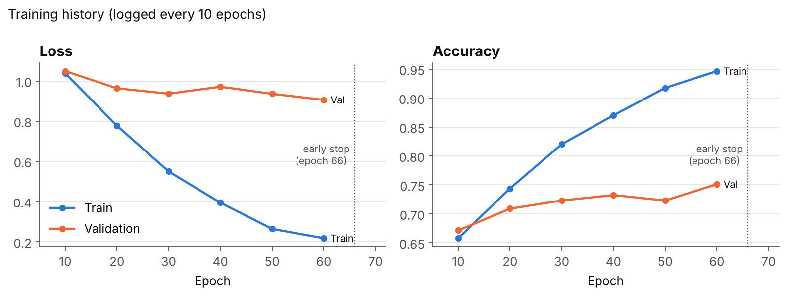

# Results

All numbers below come from `results/training_log.txt`, the raw output of the reported run. The figures can be rebuilt with `python scripts/make_figures.py`.

## 1. Overall performance

| Metric | Validation (213 blocks) | Test (72 blocks) |
|---|---:|---:|
| Accuracy | 76.06 % (best epoch) | **79.17 %** |
| Weighted precision | | 79.48 % |
| Weighted recall | | 79.17 % |
| Weighted F1-score | | 78.63 % |
| Weighted IoU (Jaccard) | | 66.97 % |
| Loss (class-weighted CE) | | 0.9118 |

Test accuracy is slightly higher than validation accuracy. With only 72 test blocks, one sample is worth about 1.4 percentage points, so the two values are within normal sampling noise of each other.

## 2. Training behaviour

| Epoch | Train loss | Train acc | Val loss | Val acc |
|---:|---:|---:|---:|---:|
| 10 | 1.0383 | 65.79 % | 1.0491 | 67.14 % |
| 20 | 0.7771 | 74.39 % | 0.9635 | 70.89 % |
| 30 | 0.5498 | 82.02 % | 0.9369 | 72.30 % |
| 40 | 0.3942 | 87.02 % | 0.9714 | 73.24 % |
| 50 | 0.2639 | 91.75 % | 0.9362 | 72.30 % |
| 60 | 0.2175 | 94.65 % | 0.9060 | 75.12 % |

- Training loss falls steadily, while validation loss flattens out after about 30 epochs.
- Early stopping ended training at **epoch 66** (no validation-loss improvement for 30 epochs).
- The gap between training (94.7 %) and validation (75.1 %) accuracy at epoch 60 shows the model still overfits, despite dropout and weight decay. With about 1,100 training blocks, more data or stronger structural priors are the most promising ways to close this gap.

## 3. Per-class performance

| Class | Test samples | Precision | Recall | F1 |
|---|---:|---:|---:|---:|
| 2lanes | 24 | 0.846 | 0.917 | 0.880 |
| 3lanes | 11 | 0.692 | 0.818 | 0.750 |
| crossing | 7 | 0.667 | 0.571 | 0.615 |
| split4lanes | 8 | 1.000 | 0.625 | 0.769 |
| split6lanes | 12 | 0.923 | 1.000 | 0.960 |
| transition | 10 | 0.556 | 0.500 | 0.526 |

Per-class values are derived from the confusion matrix in the log.

## 4. Error analysis

**Strong classes**

- `split6lanes`: all 12 test blocks correct, likely because wide, divided carriageways have a distinctive geometry with a clear central separation.
- `2lanes`: 22 of 24 correct, helped by being the largest class.

**Weak classes**

- `transition` is the hardest class (F1 0.53). Of 10 transition blocks, 3 were predicted as `2lanes` and 2 as `3lanes`. In the other direction, 2 `3lanes` blocks were predicted as `transition`. This is expected: a transition is a road changing from one lane count to another, so part of the block looks like each of its neighbours. A single global feature from max pooling has no notion of *where* in the block the change happens.
- `crossing` (F1 0.62) is the smallest class (105 training samples) and its errors are spread over three other classes.
- `split4lanes` has perfect precision but only 0.625 recall: when the model says "split 4 lanes" it is always right, but it misses 3 of 8 such blocks.

## 5. Findings from development

These observations come from experiments run while developing the model (earlier runs are not part of the logged results):

| Change | Effect on accuracy |
|---|---|
| Min-max normalisation of features | Largest single improvement |
| Dropout + weight decay | Reduced overfitting |
| Data augmentation (rotation, jitter, scale, shift, point dropout) | Lowered accuracy, so switched off |
| More or fewer than the 11 selected features | Lowered accuracy |

## 6. Possible improvements

1. **Hierarchical point features** (PointNet++, DGCNN) to capture local structure such as lane markings and medians, which should help `transition` and `crossing`.
2. **T-Net alignment** from the original PointNet, as orientation changes from augmentation hurt the current model.
3. **Fixed-size sampling** (random or farthest-point) instead of zero padding, to cut memory use and training time.
4. **Stratified k-fold cross-validation** for a more reliable estimate on the small classes.
5. **Engineered features along the road axis**, for example lane-width or cross-section profiles at several positions, to describe how the road changes within a block.
